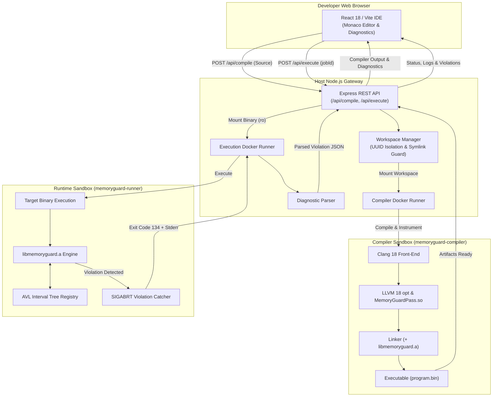

# MemoryGuard: Compiler-Assisted Heap Memory Protection System

MemoryGuard is an end-to-end, compiler-assisted heap memory protection platform designed for C and C++ applications. It combines an **LLVM 18 New Pass Manager** instrumentation plugin with an **augmented C runtime library**, a **Node.js/Express API gateway**, dual **hardened Docker execution sandboxes**, and an interactive **React/Vite web IDE**.

---

## Table of Contents

1. [Project Overview](#1-project-overview)
2. [Problem Statement](#2-problem-statement)
3. [Objectives](#3-objectives)
4. [Main Features](#4-main-features)
5. [Technology Stack](#5-technology-stack)
6. [Architecture](#6-architecture)
7. [Compilation Pipeline](#7-compilation-pipeline)
8. [Runtime Checking Mechanism](#8-runtime-checking-mechanism)
9. [Repository Structure](#9-repository-structure)
10. [Prerequisites](#10-prerequisites)
11. [Installation and Setup](#11-installation-and-setup)
12. [Docker Image Build Instructions](#12-docker-image-build-instructions)
13. [Backend Startup](#13-backend-startup)
14. [Frontend Startup](#14-frontend-startup)
15. [Usage Instructions](#15-usage-instructions)
16. [Example C and C++ Programs](#16-example-c-and-c-programs)
17. [Example Memory Errors](#17-example-memory-errors)
18. [Test Execution Commands](#18-test-execution-commands)
19. [Benchmark Results](#19-benchmark-results)
20. [Known Limitations](#20-known-limitations)
21. [Security Model](#21-security-model)
22. [Future Improvements](#22-future-improvements)

---

## 1. Project Overview

MemoryGuard delivers transparent, compiler-level spatial and temporal memory safety for heap allocations in C and C++ programs. Without requiring source code modifications, MemoryGuard inspects LLVM intermediate representation (IR), identifies heap-derived pointers via recursive provenance analysis, and injects runtime boundary checks preceding memory load and store instructions.

When compiled code executes inside a restricted container sandbox, an active **AVL Interval Tree** tracking engine validates every memory dereference in $O(\log N)$ time, instantly trapping out-of-bounds reads/writes and use-after-free violations before memory corruption can compromise the host.

---

## 2. Problem Statement

C and C++ remain the foundational languages for systems software, high-performance computing, and systems infrastructure due to their raw execution speed and granular memory control. However, manual memory management lacks inherent spatial and temporal safety guarantees. According to security industry research, memory safety vulnerabilities (e.g. CWE-119 out-of-bounds access, CWE-416 use-after-free) consistently account for approximately 70% of all critical software vulnerabilities.

Existing detection tools suffer from significant trade-offs:
- **Binary Translation Emulators (e.g., Valgrind)**: Incur severe 20x–100x execution slowdowns, rendering them impractical for throughput-sensitive workloads.
- **Compiler Sanitizers (e.g., AddressSanitizer)**: Highly effective for development and debugging, but utilize heavyweight shadow memory layouts and non-customizable runtime architectures that do not cleanly integrate into lightweight containerized web playgrounds.
- **Manual Audits**: Labor-intensive, subjective, and unable to scale across large dynamic codebases.

MemoryGuard addresses this gap by providing an automated, compiler-assisted boundary verification pipeline coupled with isolated, web-accessible execution containers.

---

## 3. Objectives

- **Automated Compile-Time Instrumentation**: Leverage the LLVM 18 New Pass Manager to statically trace pointer provenance and insert boundary checks without developer intervention.
- **Efficient Dynamic Verification**: Maintain an augmented, self-balancing AVL Interval Tree to resolve interior pointers and validate accesses in $O(\log N)$ time.
- **Complete Lifecycle Interception**: Transparently intercept standard allocation routines (`malloc`, `calloc`, `realloc`, `free`, and C++ `new`/`delete`).
- **Strict Host Isolation**: Enforce multi-layer sandboxing using separate Docker containers for compilation and execution, guaranteeing zero host filesystem exposure or network access.
- **Interactive Developer Experience**: Provide a modern browser IDE with Monaco Editor, syntax switching, real-time compilation feedback, and granular diagnostic reporting.

---

## 4. Main Features

- **Static Pointer-Origin Analysis**: Recursively classifies pointers into `HEAP_CANDIDATE`, `NON_HEAP` (stack allocas, globals), or `UNKNOWN`.
- **Pass Idempotency & Metadata Preservation**: Emits `!mg.checked` LLVM metadata to prevent redundant instrumentation.
- **Allocator Call-Site Rewriting**: Replaces standard libc allocation functions with `mg_intercept_*` equivalents that maintain the runtime registry.
- **$O(\log N)$ AVL Interval Tree Registry**: Optimizes interior pointer resolution, scaling up to 1000x faster than linear lookup lists.
- **Temporal Memory Protection**: Traps use-after-free and double-free operations immediately upon dereference.
- **Robust Realloc Handling**: Preserves original allocation metadata and handles relocating reallocations safely without pointer invalidation bugs.
- **Dual Docker Sandbox Isolation**: Separates resource-intensive compilation (`memoryguard-compiler`) from restricted execution (`memoryguard-runner`).
- **Fail-Closed Security Architecture**: Blocks host tool fallback if Docker is unavailable and enforces immutable security configurations against API tampering.
- **Path & Symlink Confinement**: Defends against symlink and directory traversal attacks via `lstatSync` and canonical `realpathSync` boundaries.

---

## 5. Technology Stack

- **Compiler & Pass**: LLVM 18, Clang 18, C++17, CMake 3.20+, Ninja.
- **C Runtime**: C11, POSIX Threads (`pthreads`), GNU libc / libstdc++.
- **Backend**: Node.js 20+, Express 4, Node.js Native Test Runner (`node --test`), Supertest, Docker Engine API.
- **Sandboxing**: Docker Engine 24+, Ubuntu 24.04 LTS (Noble Numbat).
- **Frontend**: React 18, Vite, Tailwind CSS, Monaco Editor (`@monaco-editor/react`), Lucide React, Vitest.

---

## 6. Architecture

MemoryGuard partitions duties across three isolated execution layers:



For architectural blueprints and internal sequence diagrams, see [docs/ARCHITECTURE.md](file:///D:/Notes/SEM%20VII/Compiler%20Design/Project/docs/ARCHITECTURE.md).

---

## 7. Compilation Pipeline

1. **Submission**: User submits source code and language (`c` or `cpp`) to `POST /api/compile`.
2. **Workspace Isolation**: Backend allocates an ephemeral workspace directory at `/tmp/memoryguard-workspaces/{jobId}` with strict UUID validation.
3. **Container Launch**: Spawns `memoryguard-compiler:latest` with `--network none`, `--read-only`, `--cap-drop ALL`, and unprivileged UID `10001:10001`.
4. **Textual LLVM IR Generation**: Source code is compiled to human-readable textual LLVM IR (`source.ll`) via `clang-18 -O0 -emit-llvm -S -Xclang -disable-O0-optnone`.
5. **Pass Execution**: `opt-18` loads `MemoryGuardPass.so` (`-passes=memoryguard -S`) to analyze pointer provenance, rewrite allocator calls, and inject `mg_check_access()` calls, emitting instrumented textual IR (`source_inst.ll`).
6. **Linking**: The instrumented textual IR is compiled and statically linked against `libmemoryguard.a` to produce `program.bin`.
7. **Manifest Generation**: Backend verifies the binary and writes a cryptographically validated `manifest.json`.

---

## 8. Runtime Checking Mechanism

During execution inside `memoryguard-runner:latest`:
1. **Dynamic Registration**: Allocator interceptors (`mg_intercept_malloc`, `calloc`, `realloc`) insert active memory intervals `[base, base + size)` into the global AVL tree.
2. **Access Validation**: Prior to any load or store, `mg_check_access(ptr, size, is_write, access_type)` executes:
   - Evaluates interior bounds: $\text{start} \le \text{ptr} \land \text{ptr} + \text{size} \le \text{end}$.
   - Detects integer wrap-around: $\text{ptr} + \text{size} < \text{ptr}$.
   - Checks active status (flags accesses to freed buffers).
3. **Violation Handling**: On boundary breach, the runtime emits structured diagnostic details to `stderr` and calls `abort()`, terminating with signal `SIGABRT` (exit code 134).

---

## 9. Repository Structure

```
.
├── backend/                  # Node.js Express API & Docker controllers
│   ├── src/
│   │   ├── controllers/      # compileController.js, executionController.js
│   │   ├── routes/           # compileRoutes.js, executionRoutes.js
│   │   ├── services/
│   │   │   ├── compiler/     # compilerRunner.js, compilerService.js, workspaceManager.js
│   │   │   └── execution/    # dockerRunner.js, executionService.js, diagnosticParser.js
│   │   └── server.js         # Express app initialization
│   └── tests/                # Node.js native unit and integration test suites
├── frontend/                 # React 18 / Vite developer IDE
│   ├── src/
│   │   ├── components/       # Editor, Header, Terminal, ViolationBanner
│   │   ├── samples/          # Pre-built C/C++ memory vulnerability samples
│   │   └── App.jsx           # Root layout & state management
│   └── tests/                # Vitest frontend component test suites
├── llvm-pass/                # LLVM 18 New Pass Manager Plugin
│   ├── CMakeLists.txt
│   └── src/MemoryGuardPass.cpp
├── runtime/                  # C Runtime Library
│   ├── CMakeLists.txt
│   ├── include/memoryguard.h
│   ├── src/memoryguard.c     # AVL interval tree, interceptors, checker
│   └── tests/                # CTest unit tests for runtime & pass
├── docker/                   # Hardened container definitions
│   ├── Dockerfile.compiler   # Clang 18, Opt 18, Pass plugin, Linker
│   ├── Dockerfile.runner     # Minimal unprivileged C/C++ execution environment
│   └── compile_runner.sh     # Compiler container driver script
├── benchmarks/               # Performance measurement framework
│   ├── benchmarks.c          # C benchmark workloads (Small, Med, Large)
│   └── run_benchmarks.py     # Benchmark orchestrator & reporter
└── docs/                     # Architectural & technical specifications
    ├── ARCHITECTURE.md       # Full architectural specification
    ├── SECURITY.md           # Security threat model & container hardening
    ├── TESTING.md            # Comprehensive test strategy & matrix
    ├── LIMITATIONS.md        # Technical boundaries & non-claims
    └── BENCHMARKS.md         # Empirical benchmark results & analysis
```

---

## 10. Prerequisites

- **Docker Engine**: Version 24.0+ (Linux containers enabled).
- **Node.js**: Version 20.x or 18.x LTS and `npm`.
- **Operating System**: Linux (Ubuntu 22.04/24.04 recommended), WSL2 on Windows, or macOS with Docker Desktop.
- **LLVM / Clang (Optional for native pass builds)**: Version 18.1+.
- **CMake & Ninja (Optional for native runtime builds)**: CMake 3.20+, Ninja 1.10+.

---

## 11. Installation and Setup

### 1. Clone Repository
```bash
git clone https://github.com/your-org/memoryguard.git
cd memoryguard
```

### 2. Native Runtime and LLVM Pass Build (Linux / WSL2)
```bash
mkdir -p build && cd build
cmake -G Ninja -DCMAKE_BUILD_TYPE=Release ..
ninja
cd ..
```

### 3. Install Backend Dependencies
```bash
cd backend
npm install
cd ..
```

### 4. Install Frontend Dependencies
```bash
cd frontend
npm install
cd ..
```

---

## 12. Docker Image Build Instructions

Build both the compiler sandbox and runtime runner container images from the repository root:

```bash
# 1. Build the compiler sandbox container (798 MB)
docker build -f docker/Dockerfile.compiler -t memoryguard-compiler:latest .

# 2. Build the runtime runner sandbox container (127 MB)
docker build -f docker/Dockerfile.runner -t memoryguard-runner:latest .
```

Verify that both images are registered:
```bash
docker images | grep memoryguard
```

---

## 13. Backend Startup

1. Configure environment variables:
   ```bash
   cd backend
   cp .env.example .env
   ```
2. Start the Express backend:
   ```bash
   # Development mode with auto-reload (nodemon)
   npm run dev

   # Or production mode
   npm start
   ```
3. Verify backend health:
   ```bash
   curl http://localhost:5000/api/health
   ```

---

## 14. Frontend Startup

1. Start the Vite development server:
   ```bash
   cd frontend
   npm run dev
   ```
2. Open your browser and navigate to `http://localhost:5173`.

---

## 15. Usage Instructions

1. **Author Code**: Write or edit C/C++ code in the Monaco Editor.
2. **Select Samples**: Choose from pre-configured vulnerability presets (OOB Write, OOB Read, Use-After-Free) via the sample selector.
3. **Compile**: Click **Compile**. Diagnostics, LLVM IR analysis, and compiler warnings appear in the analysis pane.
4. **Execute**: Click **Run**. The binary executes inside `memoryguard-runner:latest`.
5. **Inspect Output**: If a memory boundary is violated, execution halts immediately with `SIGABRT` and a red diagnostic banner displays the exact violating pointer, allocation range, and byte offset.

---

## 16. Example C and C++ Programs

### Valid C Program
```c
#include <stdio.h>
#include <stdlib.h>

int main(void) {
    int *arr = (int *)malloc(5 * sizeof(int));
    if (!arr) return 1;

    for (int i = 0; i < 5; i++) {
        arr[i] = (i + 1) * 10;
    }

    int sum = 0;
    for (int i = 0; i < 5; i++) {
        sum += arr[i];
    }

    printf("Sum: %d\n", sum);
    free(arr);
    return 0;
}
```

### Valid C++ Program
```cpp
#include <iostream>
#include <vector>
#include <numeric>

int main() {
    std::vector<int> nums = {10, 20, 30, 40, 50};
    int total = std::accumulate(nums.begin(), nums.end(), 0);
    std::cout << "Vector Total: " << total << std::endl;
    return 0;
}
```

---

## 17. Example Memory Errors

### 1. Heap Out-of-Bounds Write
```c
#include <stdlib.h>

int main(void) {
    int *buffer = (int *)malloc(4 * sizeof(int)); // 16 bytes allocated
    buffer[4] = 99; // Index 4 is 17-20 bytes (OUT OF BOUNDS WRITE)
    free(buffer);
    return 0;
}
```
**Runtime Output**:
```
=================================================================
== MEMORYGUARD VIOLATION DETECTED ==
Violation Type : Out-of-Bounds Write
Target Pointer : 0x00007ffc9a10b010
Access Size    : 4 bytes
Allocation Base: 0x00007ffc9a10b000 - 0x00007ffc9a10b010 (Size: 16)
Status         : Access extends 4 bytes beyond allocation boundary
=================================================================
```

### 2. Use-After-Free (UAF)
```c
#include <stdio.h>
#include <stdlib.h>

int main(void) {
    int *val = (int *)malloc(sizeof(int));
    *val = 42;
    free(val);

    // Reading from deallocated memory
    printf("Value: %d\n", *val);
    return 0;
}
```
**Runtime Output**:
```
=================================================================
== MEMORYGUARD VIOLATION DETECTED ==
Violation Type : Use-After-Free (Dereference of Unregistered/Freed Heap Memory)
Target Pointer : 0x00007ffc9a10b000
Access Size    : 4 bytes
Status         : Target address does not belong to any active allocation
=================================================================
```

---

## 18. Test Execution Commands

```bash
# 1. Run all backend tests (119 tests: 74 unit + 45 integration)
cd backend && npm test

# 2. Run backend unit tests only (74 tests)
cd backend && npm run test:unit

# 3. Run backend integration tests only (45 tests)
cd backend && npm run test:integration

# 4. Run frontend tests (30 unit & component tests)
cd frontend && npm test

# 5. Run runtime & pass CTest regression suite (5 tests)
cd build && ctest --output-on-failure

# 6. Run live Docker end-to-end integration test
cd backend && node --test tests/integration/dockerRealEndToEnd.test.js
```

> [!NOTE]
> **Test Reconciliation & Accounting**:
> - The 12 live Docker integration tests are a subset of the 45 backend integration tests.
> - **Total Unique Tests: 154** (74 Backend Unit + 45 Backend Integration + 30 Frontend + 5 Runtime CTest). No tests are double-counted.

---

## 19. Benchmark Results

Measurements collected under identical `-O2` optimization for both baseline and instrumented binaries on `Linux-6.6.87.2-WSL2-x86_64` using `clock_gettime(CLOCK_MONOTONIC)` with 64-bit checksum verification and inline assembly memory barriers (`escape_ptr`):

| Workload | Scale | Effective Ops | Baseline ns/op | Inst ns/op | Slowdown | Checksum |
|:---|:---|---:|---:|---:|---:|:---:|
| `malloc_free` | Small (1K) | 5,000,000 | 8.26 | 154.03 | **18.64x** | PASS |
| `seq_read_write` | Small (1K) | 5,000,000 | 3.55 | 198.11 | **55.75x** | PASS |
| `random_access` | Small (1K) | 641,000 | 14.42 | 351.54 | **24.39x** | PASS |
| `malloc_free` | Medium (100K) | 12,100,000 | 8.36 | 128.24 | **15.34x** | PASS |
| `seq_read_write` | Medium (100K) | 121,100,000 | 0.97 | 41.64 | **43.02x** | PASS |
| `random_access` | Medium (100K) | 49,600,000 | 1.55 | 42.67 | **27.59x** | PASS |
| `malloc_free` | Large (1M) | 13,000,000 | 8.51 | 129.47 | **15.21x** | PASS |
| `seq_read_write` | Large (1M) | 97,000,000 | 0.92 | 39.99 | **43.46x** | PASS |
| `random_access` | Large (1M) | 66,000,000 | 1.57 | 39.76 | **25.25x** | PASS |

### AVL Interval Tree Microbenchmark
| Active Heap Buffers ($N$) | Linked List Query | AVL Interval Query | Speedup Factor |
|---:|---:|---:|---:|
| **100** | 124.2 ns | 88.7 ns | **1.4x** |
| **1,000** | 1,450.6 ns | 190.8 ns | **7.6x** |
| **10,000** | 18,250.0 ns | 169.9 ns | **107.4x** |
| **100,000** | 215,980.0 ns | 209.0 ns | **1033.4x** |

> [!NOTE]
> **Disjoint Interval Complexity**: Because active dynamic heap allocations never overlap in address space, interior pointer queries search a tree of mutually disjoint intervals. With subtree `max_end` pruning and start-address ordering, point containment resolves in $O(\log N)$ time ($h \le 1.44 \log_2 N$). For arbitrary, non-disjoint intervals, interval overlap queries without disjointness would require subtree backtracking.

For complete benchmark methodology and profiling analysis, see [docs/BENCHMARKS.md](file:///D:/Notes/SEM%20VII/Compiler%20Design/Project/docs/BENCHMARKS.md).

---

## 20. Known Limitations

> [!IMPORTANT]
> MemoryGuard is a compiler-assisted heap boundary checking system and sandboxed execution environment. It is **not** a formal mathematical memory-safety proof system.

1. **Heap Only**: Stack buffer overflows (`char stack_arr[10];`) and global memory structures are out of scope.
2. **Lowered Intrinsics**: Direct compiler intrinsics like `@llvm.memcpy` Lowered directly to inline assembly bypass checks.
3. **Multithreaded TOCTOU Races**: Concurrently freeing a buffer between another thread's `mg_check_access()` check and its raw hardware load/store is not blocked.
4. **Custom Allocators**: Applications managing memory directly via raw `mmap()` or custom memory arenas bypass standard allocator interception.

For a comprehensive breakdown of supported, partially supported, and unsupported paradigms, see [docs/LIMITATIONS.md](file:///D:/Notes/SEM%20VII/Compiler%20Design/Project/docs/LIMITATIONS.md).

---

## 21. Security Model

- **Dual-Container Sandboxing**: Full separation between compilation toolchain and runtime runner.
- **Unprivileged Non-Root Execution**: Containers run under dedicated unprivileged non-root UID `10001:10001` (distinct from host-level rootless Docker daemon mode).
- **Absolute Network Isolation**: Both containers run with `--network none`.
- **Read-Only Root Filesystems**: Both containers execute with `--read-only`.
- **No New Privileges & Dropped Capabilities**: `--security-opt no-new-privileges:true` and `--cap-drop ALL`.
- **Tamper-Resistant Configuration**: `IMMUTABLE_SECURITY` configuration blocks API callers from altering sandbox flags.
- **Path & Symlink Traversal Protection**: Multi-step validation using UUID format checks, `fs.lstatSync().isSymbolicLink()`, and `fs.realpathSync()`.
- **Fail-Closed Operation**: Zero host-side compiler fallback in production.

For detailed threat modeling and audit details, see [docs/SECURITY.md](file:///D:/Notes/SEM%20VII/Compiler%20Design/Project/docs/SECURITY.md).

---

## 22. Future Improvements

1. **Stack & Global Memory Protection**: Extend the LLVM pass to track stack frame boundaries (`AllocaInst`) and global data segment symbols.
2. **Intrinsic Call Interception**: Expand `@llvm.memcpy`, `@llvm.memmove`, and `@llvm.memset` into checked memory loops or intercepted wrapper routines.
3. **Thread-Local Allocation Arenas**: Replace single-mutex AVL tree synchronization with thread-local cache pools or reader-writer locks (`pthread_rwlock_t`) to reduce multithreaded contention.
4. **WebAssembly Target**: Implement a WebAssembly compilation backend for client-side execution within browser sandboxes.
5. **CI/CD Automation**: Provide automated GitHub Actions workflows running the full Docker E2E test matrix on every commit.

---

## License

This project is licensed under the Apache 2.0 License.
