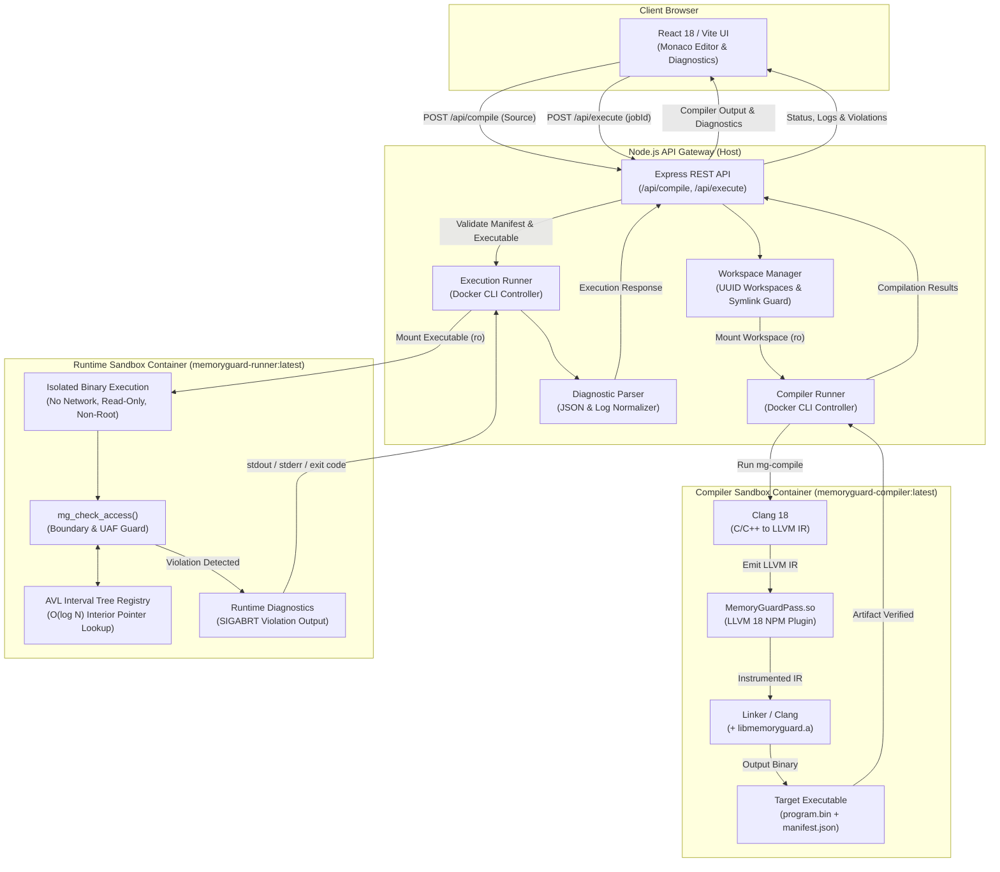
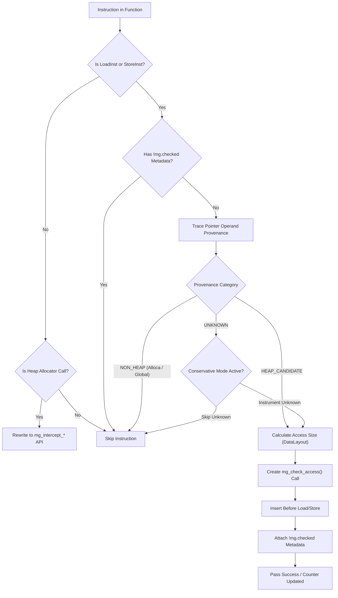
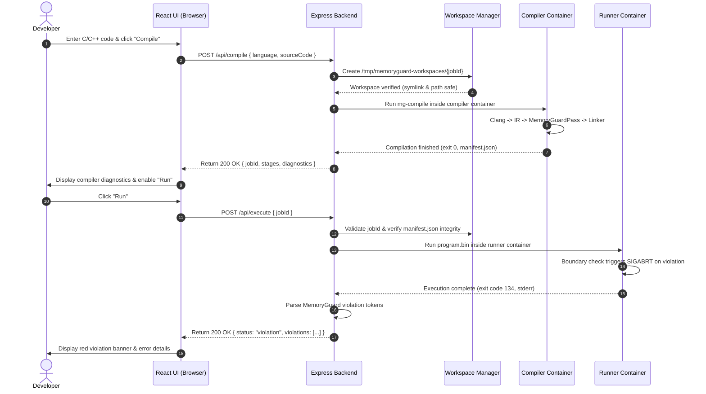

# MemoryGuard Architecture Specification

MemoryGuard is an end-to-end, compiler-assisted heap memory protection platform designed for C and C++ programs. It couples an **LLVM 18 New Pass Manager** instrumentation plugin with an **augmented C runtime library**, coordinated by a **Node.js/Express backend**, isolated within **hardened Docker containers**, and operated through an interactive **React/Vite web application**.

---

## 1. System Architecture Overview

The MemoryGuard architecture is divided into three distinct execution domains:

1. **User & Orchestration Domain**:
   - **Frontend (React 18 + Vite + Monaco Editor)**: Code authoring, syntax highlighting, sample loading, compilation triggers, execution invocation, and visual diagnostics reporting.
   - **Backend (Node.js 20 + Express)**: API gateway, job lifecycle management, UUID workspace isolation, compiler orchestration, runtime container runner, and structured diagnostics parsing.
2. **Compiler Domain (Docker Sandbox: `memoryguard-compiler`)**:
   - **Clang 18 Toolchain**: Front-end compilation to LLVM intermediate representation (IR).
   - **MemoryGuard LLVM 18 Pass Plugin (`MemoryGuardPass.so`)**: Static pointer-origin analysis, heap allocation interception, and runtime boundary check injection.
   - **Runtime Linker**: Static linkage against `libmemoryguard.a` to produce the hardened executable (`program.bin`).
3. **Execution Domain (Docker Sandbox: `memoryguard-runner`)**:
   - **Unprivileged Sandbox**: Non-root execution (`10001:10001`), read-only root filesystem, `--network none`, dropped Linux capabilities, and strict CPU/memory/PIDs limits.
   - **MemoryGuard C Runtime (`libmemoryguard.a`)**: Thread-safe AVL interval tree allocation registry, real-time boundary verification (`mg_check_access`), signal handling, and formatted violation reporting.



---

## 2. LLVM Instrumentation Pass Architecture

The compiler pass is implemented as a modern LLVM 18 New Pass Manager plugin (`llvm::PassInfoMixin<MemoryGuardPass>`), dynamically loaded via `opt -load-pass-plugin=MemoryGuardPass.so -passes=memoryguard`.

### 2.1 Pass Pipeline & Traversal

1. **Module & Function Scanning**: Traverses all functions within the LLVM Module (`Module::functions()`). External declarations and MemoryGuard runtime helper functions (`mg_*`) are skipped to prevent recursive instrumentation loops.
2. **Allocation Call Interception**:
   - Identifies standard heap allocation calls: `malloc`, `calloc`, `realloc`, and `free`.
   - Injects call-site rewrites replacing `malloc(sz)` with `mg_intercept_malloc(sz)`, `calloc(n, sz)` with `mg_intercept_calloc(n, sz)`, `realloc(ptr, sz)` with `mg_intercept_realloc(ptr, sz)`, and `free(ptr)` with `mg_intercept_free(ptr)`.
   - Interceptors automatically register allocated heap intervals into the runtime's AVL tree.
3. **Pointer-Origin & Provenance Analysis**:
   - For every memory access instruction (`llvm::LoadInst` and `llvm::StoreInst`), recursively traces the pointer operand backwards through the LLVM def-use chain.
   - Classification categories:
     - `HEAP_CANDIDATE`: Traced directly to an allocation call, a heap-derived `GetElementPtrInst` (GEP), or a pointer loaded from a heap buffer.
     - `NON_HEAP`: Statically proven stack allocation (`AllocaInst`) or global/static variable (`GlobalVariable`).
     - `UNKNOWN`: Function parameters, opaque external calls, complex phi-nodes, or int-to-ptr casts.
4. **Boundary Check Insertion**:
   - For qualified pointer candidates, calculates the accessed element size using the target machine's `llvm::DataLayout`.
   - Emits a direct call to `mg_check_access(ptr, size, is_write, access_type)` immediately prior to the `LoadInst` or `StoreInst`.
   - Applies LLVM metadata tags (`!mg.checked`) to inserted check instructions to ensure pass idempotency.



---

## 3. C Runtime Library Architecture

The runtime library (`libmemoryguard.a`) provides the memory allocation tracking engine and dynamic validation logic.

### 3.1 Allocation Registry: Self-Balancing AVL Interval Tree

Rather than using an $O(N)$ linear linked list, MemoryGuard maintains an augmented AVL interval tree:

- **Node Attributes**:
  ```c
  typedef struct mg_alloc_node {
      uintptr_t start;             /* Allocation base address */
      uintptr_t end;               /* Allocation upper bound: start + size */
      size_t size;                 /* Payload size in bytes */
      int is_active;               /* Active status flag (1 = active, 0 = freed) */
      int owns_payload;            /* 1 if runtime allocated, 0 if external */
      int height;                  /* AVL tree subtree height */
      struct mg_alloc_node *left;  /* Left subtree */
      struct mg_alloc_node *right; /* Right subtree */
  } mg_alloc_node_t;
  ```
- **Disjoint Interval Search ($O(\log N)$)**:
  Given an interior pointer `P` and access size `S`, the registry locates the enclosing allocation interval:
  $$\text{start} \le P \quad \land \quad P + S \le \text{end}$$
  If $P + S < P$, an integer overflow has occurred and the check fails immediately.
  *Algorithmic Guarantee*: Because active heap allocations in valid program memory are mutually disjoint (non-overlapping), at most one allocation can contain address `P`. Searching ordered `start` addresses with subtree `max_end` pruning guarantees a single descent path bounded by tree height $h \le 1.44 \log_2 N = O(\log N)$. (For arbitrary, non-disjoint overlapping intervals, interval overlap queries without disjointness would require subtree backtracking).
- **Self-Balancing Invariants**: Standard AVL rotations (Left-Left, Right-Right, Left-Right, Right-Left) ensure $O(\log N)$ worst-case insertion, deletion, and lookup time.
- **Concurrency**: Thread-safe access is guaranteed via internal POSIX pthread mutexes (`pthread_mutex_t registry_mutex`), protecting registry operations against race conditions in multi-threaded programs.

### 3.2 Violation Detection and Reporting

When `mg_check_access(ptr, size, is_write, access_type)` detects a safety breach:
1. It formats a standardized diagnostic message to `stderr`:
   ```
   =================================================================
   == MEMORYGUARD VIOLATION DETECTED ==
   Violation Type : Out-of-Bounds Write
   Target Pointer : 0x00007ffc8213b028
   Access Size    : 4 bytes
   Allocation Base: 0x00007ffc8213b000 - 0x00007ffc8213b020 (Size: 32)
   Status         : Access extends 8 bytes beyond allocation boundary
   =================================================================
   ```
2. The runtime issues `abort()`, terminating execution with signal `SIGABRT` (exit code 134).
3. The execution service captures `stderr`, parses the diagnostic fields, and maps them to structured JSON for the frontend.

---

## 4. Container Isolation Architecture

Compilation and execution are decoupled into two distinct, security-hardened Docker containers:

| Dimension | Compiler Sandbox (`memoryguard-compiler:latest`) | Runtime Sandbox (`memoryguard-runner:latest`) |
|:---|:---|:---|
| **Base Image** | Ubuntu 24.04 (Noble) | Ubuntu 24.04 (Noble, Minimal) |
| **Installed Packages** | `clang-18`, `llvm-18`, `build-essential` | Minimal C/C++ runtime (`libc6`, `libstdc++6`) |
| **Image Size** | 798 MB | 127 MB |
| **User Identity** | `mgcompiler` (UID: 10001, GID: 10001) | `mgrunner` (UID: 10001, GID: 10001) |
| **Networking** | `--network none` | `--network none` |
| **Root Filesystem** | `--read-only` | `--read-only` |
| **Linux Capabilities** | Dropped all (`--cap-drop ALL`) | Dropped all (`--cap-drop ALL`) |
| **Security Options** | `no-new-privileges:true` | `no-new-privileges:true` |
| **Memory Limit** | 512 MB | 128 MB |
| **CPU Limit** | 1.5 cores | 1.0 core |
| **PIDs Limit** | 128 | 32 |
| **Execution Timeout**| 15,000 ms | 5,000 ms |
| **Workspace Mount** | Assigned UUID workspace directory only | Read-only mount of `program.bin` |

---

## 5. End-to-End Execution Lifecycle



This multi-layer architecture guarantees that untrusted user code can neither compromise the host filesystem nor tamper with compiler artifacts or other concurrent execution jobs.
